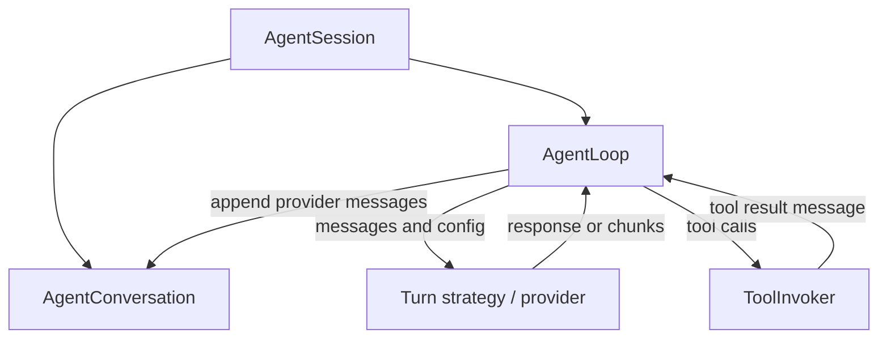

# Agent core

The agent core separates conversation data from the turn loop.
`AgentConversation` owns messages and the compaction checkpoint.
`AgentLoop` coordinates provider calls, response handling, and tool calls.
`AgentSession` composes these modules with state, logging, tools, and a provider.



## AgentConversation

`AgentConversation` stores the message sequence and a checkpoint string.
It appends or replaces messages, finds the latest user message, and combines the agent prompt with the checkpoint for provider calls.
Compaction is injected as a callback, keeping conversation state independent of a concrete pipeline.

```ts
const result = await conversation.compact(
  compactionStrategy,
  agent,
  comparisonSystemPrompt,
);
```

Compaction saves the returned summary as the checkpoint and replaces the active message list with retained messages.

## AgentLoop

`AgentLoop` runs an `AgentTurnStrategy` until the provider returns a final response or the loop reaches its limit.
It supports streamed chunks, validates normalized results, appends provider messages, and routes tool calls through `ToolInvoker`.

The loop allows up to three provider attempts per step when streaming has not started and stops after ten provider steps.
A failure after streamed output begins propagates instead of retrying a partial response.

```ts
const turn = loop.run(userMessage, streamStrategy);
for await (const chunk of turn) {
  render(chunk);
}
```

`run` is an async generator.
Consumers receive text chunks as yielded values and the completed session result as the generator return value.
