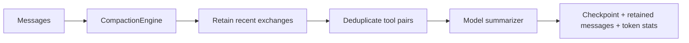

# Compaction

`CompactionEngine` measures a conversation, runs a `CompactionPipeline`, and returns a checkpoint, retained messages, and token statistics.



## Pipeline

`CompactionPipeline` links `AbstractCompactionPipelineNode` instances in order.
Each node receives the current result and returns the next result.
Execution stops when no messages remain to compact.

The current application composition retains recent exchanges, removes duplicate tool content, then summarizes older messages.
Retention treats a user message and following assistant/tool messages as an exchange.

```ts
const pipeline = new CompactionPipeline()
  .addNode(new RecentMessageRetainHandler({ threshold: 2 }))
  .addNode(new DedupeRepeatedContent())
  .addNode(new ModelSummarizer({ llmProvider, model }));
```

## Deterministic and model-based nodes

`RecentMessageRetainHandler` and `DedupeRepeatedContent` transform message data without calling a model.
They retain the configured recent exchanges and remove repeated tool call/result pairs by comparing tool name, input, and output.

`ModelSummarizer` asks a language model to summarize the remaining messages under a target token count.
Because the summary depends on model output, this node is non-deterministic.
It can issue up to two requests to rewrite an overlong summary.

```ts
const targetTokens = Math.ceil(originalTokenCount * factor);
const result = await provider.generateText({
  config: { model, systemPrompt, availableTools: [] },
  messages: sourceMessages,
});
```

The engine records before/after token counts, tokens saved, and reduction ratio.
