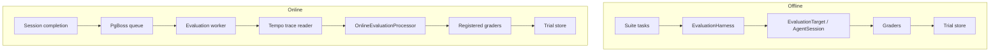

# Evaluation

Evaluation supports offline suite runs and asynchronous online grading.
Both modes use graders, a trial store, and evaluation metrics.



## Offline evaluation

An `EvaluationSuite` contains tasks, each with an input and one or more graders.
`EvaluationHarness` runs each task against an `EvaluationTarget`, grades the output, saves a trial, and records metrics.
The current adapter creates an `AgentSession` for each task.

```ts
const harness = new EvaluationHarness({ target, trialStore });
const suiteRun = await harness.runSuite(suite);
```

The harness rejects empty suites, duplicate task IDs, tasks without graders, and duplicate grader IDs within a task.
The `evaluation:run` script executes suites registered in `AgentSuiteRegistry`.

## Online evaluation

The online path queues a message containing schema version, trace ID, session ID, and agent name.
The worker reads the completed trace from Tempo, selects the agent's grading profile, saves the trial, and records metrics.
The queue uses the session ID as a singleton key, and the processor checks for an existing trial before grading.

```ts
await publisher.enqueue({
  schemaVersion: 2,
  traceId,
  sessionId,
  agentName,
});
```

Online evaluation grades a completed trace; it does not rerun the agent.
Offline evaluation executes predefined inputs through an evaluation target.

## Graders and trials

Graders return a pass result, score, and optional details.
The repository includes response-presence, tool-call expectation, and LLM-judge graders.
Trial records preserve suite/task identity, grader outcomes, metadata, errors, and evaluation time.
