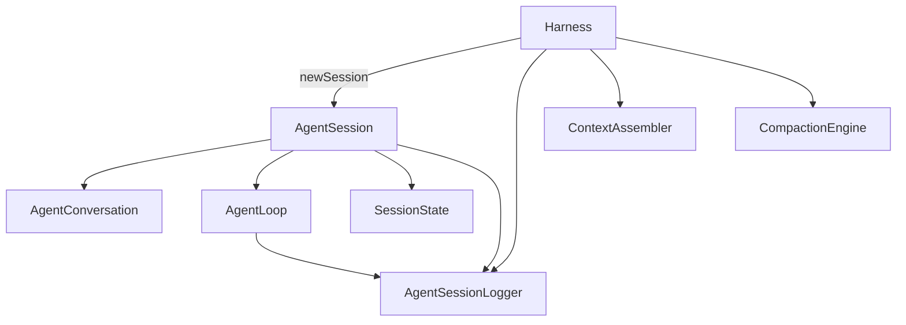
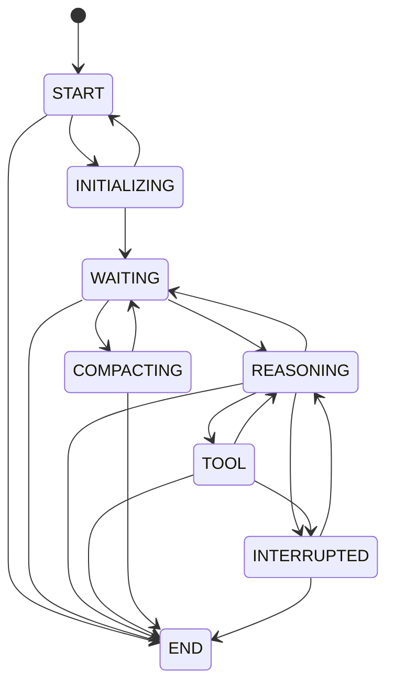

# Harness

`Harness` creates and tracks `AgentSession` instances.
It supplies session IDs, a `SessionState`, context assembly, compaction, and a shared `AgentSessionLogger`.
The harness is the composition boundary; conversation and turn-loop logic live in separate modules.



## AgentSession

`AgentSession` connects the provider, agent configuration, conversation, tool invoker, state, context assembler, and logger.
It builds generate and streaming strategies from the provider interface and constructs an `AgentLoop`.
Loop hooks update session state and emit session events.

```ts
const session = harness.newSession({ llmProvider, agent, model });
const result = await session.sendMessage("Hello");
```

At session start, context is prepared through `ContextAssembler`.
The session exposes message sending, streaming, compaction, and current state to its caller.

## AgentSessionLogger: session logging

`AgentSessionLogger` writes lifecycle and tool call/result events to a text file named for the session ID.
Writes are queued per session so events from one session are serialized.

```ts
const line = String(Date.now()) + "::" + formatEvent(eventType, context) + "\n";
this.enqueue(sessionId, async () => {
  const stream = this.streams.get(sessionId);
  if (stream && !stream.write(line)) await once(stream, "drain");
});
```

Closing the harness closes the logger and waits for queued writes to finish.

## SessionState: state management

`SessionState` validates lifecycle transitions and stores interruption details when the session is interrupted during reasoning or tool execution.
Details include the user message, partial reply, error message, and timestamp.



Only `interrupt(details)` can enter `INTERRUPTED`, and it does so only from `REASONING` or `TOOL`.
`END` has no outgoing transitions.

```ts
sessionState.transitionTo(SessionStatus.REASONING);
sessionState.transitionTo(SessionStatus.TOOL);
sessionState.transitionTo(SessionStatus.WAITING);
```

Call `interrupt(details)` to enter the interrupted state.
Direct transition to `INTERRUPTED` is rejected.
