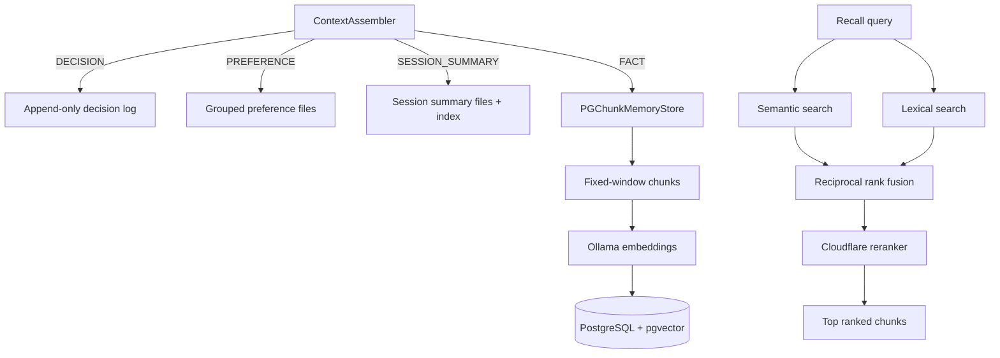
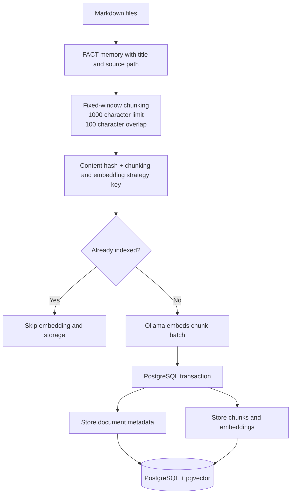
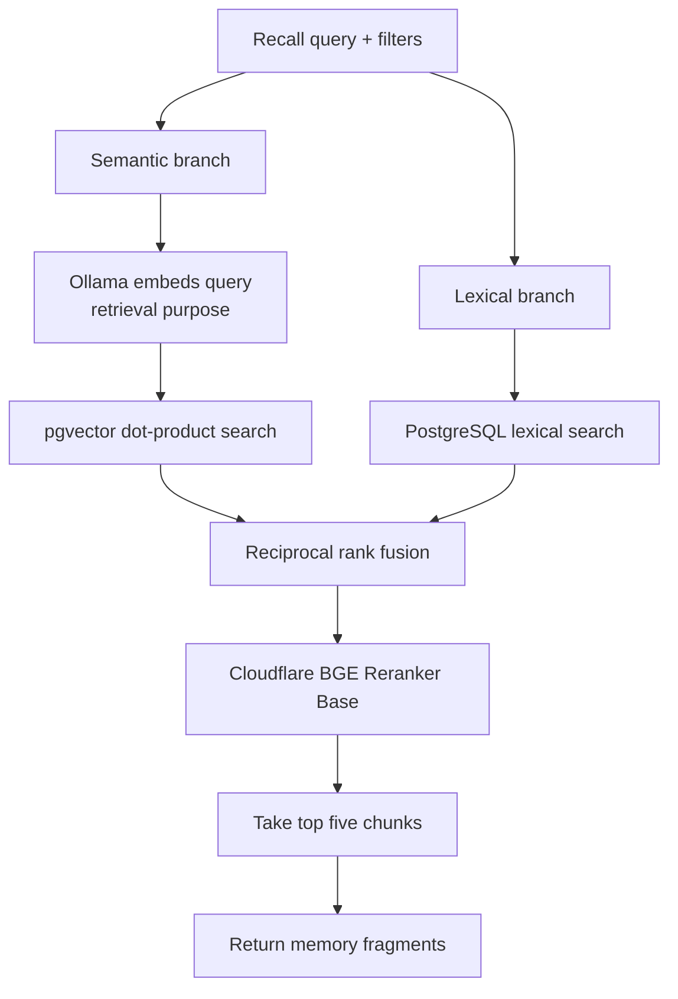

# Memory

`ContextAssembler` routes `FACT` memory to PostgreSQL RAG and routes decisions, preferences, and session summaries to the local file store.
It also assembles preference context for new sessions and delegates memory compaction to `CompactionEngine`.



## Three local memory types

`LocalFileMemoryStore` selects a strategy based on the memory type.

### Decisions

Decision records are appended to a log with creation time, tags, origin, and session ID metadata.
Retrieval uses a checkpoint to track progress through the decision log.

### Preferences

Preferences are grouped into Markdown files.
A group index tracks metadata and file paths.
Writes replace the addressed preference chunk atomically.

### Session summaries

Each session summary is stored in a per-session Markdown file.
An index stores the session file name and summary used during retrieval.

```ts
switch (memory.type) {
  case MEMORY_TYPE.DECISION: return decisionStrategy;
  case MEMORY_TYPE.PREFERENCE: return preferenceStrategy;
  case MEMORY_TYPE.SESSION_SUMMARY: return sessionSummaryStrategy;
}
```

The local store handles these three types.
`FACT` memories use the PostgreSQL RAG store.

## RAG

`PGChunkMemoryStore` handles two distinct flows: indexing facts into searchable chunks and retrieving relevant chunks for a query.

### Embedding and indexing flow

The indexing script reads Markdown files recursively and converts each file into a `FACT` memory with its title and source path.
The store splits content into fixed-window chunks of up to 1,000 characters with 100 characters of overlap.
It computes a deduplication key from the content hash and chunking and embedding strategy; an existing key skips the embed and write steps.

For new content, Ollama embeds the chunk batch.
The store then writes the document, chunks, and embeddings to PostgreSQL in a transaction.



```ts
const chunks = chunker.chunk(
  { content: memory.content },
  ChunkingStrategyType.FIXED_WINDOW,
  1000,
  100,
);
const embeddings = await embedder.embed(
  chunks.map((chunk) => chunk.content),
  EmbeddingPurpose.INDEXING,
  OllamaEmbeddingModel.EMBEDDINGGEMMA_2_270M,
);
```

### Retrieval pipeline

Retrieval embeds the query for semantic search while lexical search runs in parallel.
The semantic branch searches pgvector using the query embedding; the lexical branch searches the text.
Both branches receive the configured retrieval limit and filters.

The store combines candidate rankings with reciprocal rank fusion, reranks the fused candidates through Cloudflare Workers AI using BGE Reranker Base, and returns up to five chunks as memory fragments.



Index Markdown files from an absolute directory with:

```sh
npm run rag:index -- /absolute/path/to/markdown-files
```

Indexing requires PostgreSQL with pgvector and an Ollama embedding endpoint.
Retrieval also requires Cloudflare reranker credentials.
