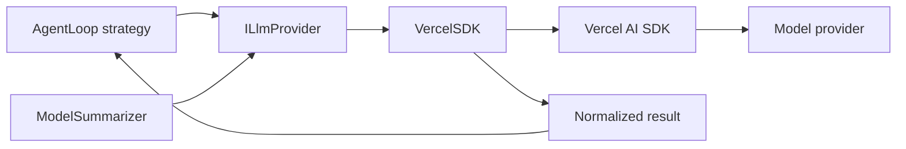

# Provider layer

The provider layer keeps the harness independent of a specific model SDK.
`ILlmProvider` defines generation and streaming using normalized messages, stop reasons, tool calls, and output.



## Provider contract

The generic model type allows callers to pass a model identifier or model object without changing the session and loop abstractions.
Generation and streaming both accept model configuration and conversation messages.

```ts
export type ILlmProvider<TModelType> = {
  generateText(input: ILlmGenerateTextInput<TModelType>): Promise<ILlmGenerateTextOutput>;
  streamText(input: ILlmStreamTextInput<TModelType>): Promise<ILlmStreamTextOutput>;
};
```

## VercelSDK adapter

`VercelSDK` implements the provider contract with the Vercel AI SDK.
It converts registered tools to SDK tools, maps SDK failures to domain errors, records token usage, and normalizes streaming and non-streaming results.

```ts
const result = await provider.generateText({
  config: { model, systemPrompt, availableTools: agent.agentTools },
  messages: conversation.messages,
});
```

`VercelSDK` is the current adapter.
Another SDK can be integrated by implementing `ILlmProvider` without changing the conversation or turn-loop contracts.
