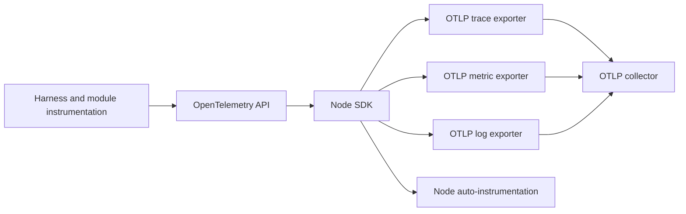

# Telemetry

Telemetry uses the OpenTelemetry API for traces and metrics, plus the Node SDK for exporters and automatic Node.js instrumentation.
The runtime starts the SDK from `src/telemetry/instrumentation.ts`.
The application and evaluation worker preload the instrumentation entry point.



The SDK adds service name, namespace, environment, and version resource attributes.
Metrics use a periodic reader with a one-second export interval.
The Compose configuration points the app and worker at `http://otel-collector:4318` with the `http/protobuf` protocol.

## Custom metrics

The following table lists selected custom metrics declared in the source.
Histogram metrics record distributions; counters record accumulated event counts.

| Area | Metric | Type | Measurement and attributes |
| --- | --- | --- | --- |
| Agent sessions | `agent-session.sessions.count` | Counter | Sessions created. |
| Agent sessions | `agent-session.turns.count` | Counter | Agent turn attempts. |
| Agent sessions | `agent-session.turn.duration` | Histogram | Turn duration in seconds. |
| Model usage | `llm.tokens.input`, `llm.tokens.output` | Counter | Input and output tokens, tagged with provider, model, and token source (`provider` or `baseline`). |
| Tools | `tool.call.count` | Counter | Logical tool call attempts, tagged by tool name and outcome. |
| Tools | `tool.call.duration` | Histogram | Tool call duration in seconds, including retries. |
| Compaction | `compaction.tokens.before`, `compaction.tokens.after`, `compaction.tokens.saved` | Histogram | Baseline token counts before and after compaction and the difference. |
| Compaction | `compaction.token.reduction.ratio` | Histogram | Share of baseline context tokens removed. |
| Compaction pipeline | `compaction.pipeline.count` | Counter | Pipeline runs, tagged by outcome. |
| Compaction pipeline | `compaction.pipeline.duration`, `compaction.pipeline.node.duration` | Histogram | Pipeline and individual node duration in seconds. |
| Summary generation | `compaction.summary.nudges` | Histogram | Shortening nudges used by the model summarizer. |
| Summary generation | `compaction.summary.outcomes` | Counter | Summary outcomes, including whether the target factor was met. |
| Evaluation | `evaluation.trials.count` | Counter | Completed trials, tagged by mode, evaluation name, and pass/fail result. |
| Evaluation | `evaluation.score` | Histogram | Grader scores, tagged by mode, evaluation, and grader ID. |
| Context assembly | `context.operation.count` | Counter | Context operations, tagged by operation and success/error outcome. |
| Context assembly | `context.operation.duration` | Histogram | Context operation duration in seconds. |
| RAG | `rag.operation.count` | Counter | RAG operations, tagged by stage and success/error outcome. |
| RAG | `rag.operation.duration` | Histogram | RAG operation duration in seconds, including store, query embedding, semantic search, lexical search, reranking, and retrieval. |

These are custom application instruments.
The SDK also enables automatic Node.js instrumentation.

## Creating instruments

Modules get a meter scoped to the component and create counters or histograms for their operations.

```ts
const meter = getMeter('tool-invoker');
const callCounter = meter.createCounter('tool.call.count');
const duration = meter.createHistogram('tool.call.duration');

callCounter.add(1, { 'tool.name': toolName, 'tool.outcome': outcome });
duration.record(durationSeconds, { 'tool.name': toolName, 'tool.outcome': outcome });
```

The instrument definitions and recording sites live in the module that owns the measured operation.
