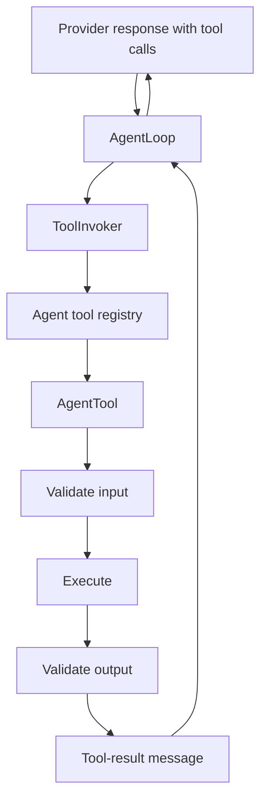

# Tools

Tools expose typed operations that an agent can request during a provider turn.
`AgentTool` defines a tool's name, schemas, and execution method.
`ToolInvoker` resolves provider calls against the agent registry and packages results for the next provider step.
The table lists implemented tools; agent configuration determines which tools are available in a given session.



## Tool catalog

| Name | Description |
| --- | --- |
| `gcal_list_events` | List Google Calendar events within an ISO date-time range. |
| `remember` | Store facts, decisions, preferences, or session summaries. List preference groups before selecting a group and file path for a preference. |
| `recall` | Retrieve relevant fact chunks, decisions, preferences, or session summaries. |
| `read_file` | Read a UTF-8 text file at an absolute path, up to 1 MiB. |
| `write_file` | Create or replace a UTF-8 text file at an absolute path, up to 1 MiB. Replaces the entire file. |
| `run_shell_command` | Run a Bash command in the workspace. Times out after 30 seconds; output is capped at 1 MiB. |
| `walk_directory` | List files and directories under an absolute directory path. Symlinks are listed but not traversed; results default to 500 entries and depth 3. This is not a filesystem sandbox. |
| `web_search` | Find current web pages relevant to a query and return ranked results with URLs and snippets. |
| [`wyd_list_tasks`](https://wyd-jaydon.duckdns.org) | List tasks in configured Wyd folders. Returned task IDs or reference IDs can be used to read or update tasks. |
| [`wyd_get_task`](https://wyd-jaydon.duckdns.org) | Read one task by ID when its folder is configured as allowed. |
| [`wyd_create_task`](https://wyd-jaydon.duckdns.org) | Create a task in a configured Wyd folder. |
| [`wyd_update_task`](https://wyd-jaydon.duckdns.org) | Update a task in a configured Wyd folder. Tags replace the full tag set; folder moves are unsupported. |

The Wyd tools link to the [Wyd project](https://wyd-jaydon.duckdns.org) and are registered only when `WYD_API_BASE_URL`, `WYD_API_TOKEN`, and `WYD_ALLOWED_FOLDER_IDS` are all configured.

## AgentTool

Each tool declares a name, description, input schema, and output schema.
`useTool` validates input, executes the implementation, then validates output.
Tool implementations provide the `execute` method.

```ts
class ExampleTool extends AgentTool<typeof InputSchema, typeof OutputSchema> {
  protected async execute(input: Input): Promise<Output> {
    return performOperation(input);
  }
}
```

## Tool loops

The provider returns tool calls in a normalized response.
`AgentLoop` passes calls to `ToolInvoker`, which resolves and invokes them sequentially in the order returned.
The invoker packages outputs into one tool message.
The loop appends that message to `AgentConversation` and calls the provider again.

```text
provider → tool calls → invoker → tool results → conversation → provider
```

Input validation errors are returned to the model as tool error text.
Other failures propagate.
Tool calls and results are recorded through the session logger, and invocation telemetry records call count, duration, and outcome.

## Tool sets

Tools are grouped by capability and supplied to an agent configuration.
The repository includes memory, workspace, Google Calendar, web search, and optional Wyd task tools.
The provider adapter exposes registered tools to the model; `ToolInvoker` performs application-side execution.
